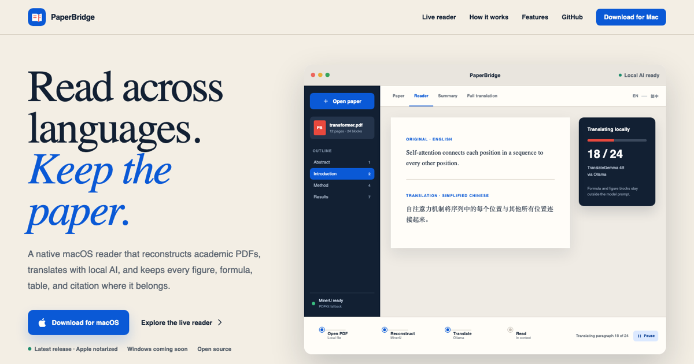

# PaperBridge Website

Marketing and interactive product-demo website for [PaperBridge](https://github.com/haoyunLi/PaperBridge), built with Vue 3, TypeScript, and Vite.



The interactive examples explain the native macOS workflow: PDF reconstruction with MinerU/PDFKit, local Ollama models, bilingual reading, summaries, selected-text tools, translated captions, and preserved figures and formulas. They use illustrative content, not screenshots or live AI. Language controls demonstrate app settings; the sample content stays English / Simplified Chinese.

## Reading reliability in 1.9

The `#reading-update` section demonstrates four locally implemented app improvements:

- Resume a stopped translation without repeating saved blocks; stop and resume the simulated task.
- Remove a highlight while keeping its note, edit the note, and undo the change.
- Scroll or jump to a passage, visit Overview, and return to the saved block; search stays above the scrollable text.
- Open a detected section from the source reading map. The displayed excerpt remains exactly the same in the example Reader, with no generated answer.

These features ship in **PaperBridge 1.9**. Its timers illustrate progress and are not performance claims. The browser examples make no document uploads or model requests. Demo notes are memory-only and disappear on page reload.

The app README includes matching feature descriptions and verification notes in `docs/reliability-update.md`. Version 1.9 contains the six reading-efficiency features below. Comprehensive paragraph reconstruction and semantic verification of AI claims are not promised.

## Feature and setup guides

`#capabilities` explains eighteen reading tasks. The original twelve cover importing, preserved resources, bilingual reading, selected-text help, summaries, full translation, annotations, navigation, export, models, recovery, and the source map. Six new chapters cover extraction checks, section translation, the local library, quick help/terminology, summary sources, and reading comfort.

Each feature includes its use case, three in-app steps, installation requirements, preserved content, practical limits, and an interactive example link. All titles remain visible in a chapter-style list, with independently expandable details and expand/collapse all. Desktop keeps the introduction alongside the chapters; mobile uses one column without a dropdown. Reduced motion and inert collapsed content are supported. Descriptions live in `src/data/features.ts`.

`FeaturePractice.vue` embeds six lightweight examples directly inside their chapters:

- Compare a cut-off sentence against fictional original context without guessing the missing words.
- Translate Abstract/Conclusion first; cancel/resume the remaining section simulation without repeating completed items.
- Search two sample library records and switch between their independent reading positions and notes.
- Review and save a preferred translation in a memory-only demonstration glossary.
- Open an illustrative source quotation and contrast it with a claim lacking a validated source link.
- Adjust text size/spacing and toggle a compact focus-reading example.

All sample papers, translations, claims, progress states, and saved terms are illustrative. They are not live model responses, benchmarks, actual user files, or persistent browser storage. In the native app, quotation validation proves location rather than correctness; glossary entries guide future prompts, not guaranteed substitutions.

`#getting-started` has three selectable routes: reading without models, translation, or optional explanation/summary. It distinguishes the ready-made DMG from a source build, keeps MinerU separate and recommended, explains TranslateGemma 4B/12B/27B, and states memory/network requirements. The hero links directly to this guide.

Privacy copy distinguishes on-device document analysis from internet-based tool downloads, update checks, and links. Structured Markdown is not described as a pixel-identical translated PDF. Unreleased features are not silently attributed to the current DMG.

### Keep the website and app documentation aligned

1. Verify behavior in the app source and tests before changing feature claims.
2. Update the app README, this README, the interactive example, and the related FAQ together.
3. Keep unreleased work labeled as a development preview. A website deployment does not publish an app update.
4. After a signed app release and update feed are published, verify its release notes before changing availability labels.
5. Keep macOS download links on the stable `releases/latest/download/PaperBridge.dmg` URL. Do not turn preview examples into a second download destination.

## Requirements

- Node.js 22.18 or newer
- npm 10 or newer

## Local development

```bash
npm install
npm run dev
```

Open the local address shown in Terminal, normally `http://localhost:5173`.

## Production build

```bash
npm run build
```

The static site is written to `dist/` and can be deployed with AWS Amplify Hosting or S3 + CloudFront.

## Deploy to AWS Amplify

The included `amplify.yml` installs the required Node version, builds the Vue app, and publishes `dist/`.

1. Push this folder to a GitHub repository, for example `PaperBridge-Website`.
2. Sign in to the AWS account that manages `paperbridges.net`.
3. Open **AWS Amplify → Create new app → GitHub**.
4. Authorize GitHub, choose the website repository and its production branch, then continue.
5. Confirm that Amplify detected `amplify.yml`, then choose **Save and deploy**.
6. After the first deployment succeeds, open **Hosting → Custom domains → Add domain**.
7. Select `paperbridges.net`, map the production branch to the root domain, and add `www` as a redirect to the root domain.
8. Choose the free **Amplify managed certificate** and finish the setup.

Because the domain is managed by Route 53 in the same AWS account, Amplify can create the required DNS verification and HTTPS records automatically. Domain activation can take time while DNS and the certificate propagate.

No environment variables or backend services are required.

For the existing site, pushes to the Amplify-connected production branch can trigger a deployment. Check that the deployment succeeded before telling users the live website has changed. A successful local build alone does not update the domain.

## Validation

Run `npm run build` for TypeScript checks and a production build, then verify the preview at desktop and mobile widths. Exercise the four original interactive examples and six new inline practices. Check all eighteen feature entries and three setup routes, keyboard focus, reduced motion, no-match search, cancellation/resume, glossary input, source expansion, typography/focus controls, console errors, and the direct-download URL. The demo must not request Ollama or upload content.

Local checks covered desktop/mobile layouts, feature/setup choices, and the four interactive examples, with no console errors or external demo requests. The former feature dropdown has been replaced with accessible disclosure buttons; verify Enter/Space, independent expansion, expand/collapse all, and no focusable links inside collapsed chapters. The design detector reports intermediate type sizes absent from the sparse `DESIGN.md` ramp; existing typography and palette were preserved rather than rewriting the design system during this feature task.

The earlier chapter presentation was checked at 1440px, 1024px, 390px, and 320px. The six-feature extension keeps that presentation rather than bringing back the disliked dropdown or screenshot swaps. Availability wording marks the newly released features as New in 1.9.

The extension passed production build and Chrome checks at 1440x1000, 390x844, and 320x740. All eighteen descriptions were present; the six practices responded correctly, including Enter expansion, cancelled section work retaining results, no-match library search, term saving, source quotations, and reading controls. No console errors or horizontal overflow were found. The small-screen reading example now places navigation above the text. Native Browser plugin was unavailable, so an isolated Playwright/Chrome session was used, with no personal browser profile. Visual review was performed in-thread; the existing sparse design-type-ramp advisories remain, and no design-system rewrite was made.

## Domain

Production domain: [paperbridges.net](https://paperbridges.net)

## Primary links

- latest macOS direct download: `https://github.com/haoyunLi/PaperBridge/releases/latest/download/PaperBridge.dmg`
- release details: `https://github.com/haoyunLi/PaperBridge/releases/latest`
- current signed release: the latest GitHub Release (Universal, Apple notarized)
- source: `https://github.com/haoyunLi/PaperBridge`
- contact: `info@paperbridges.net`
