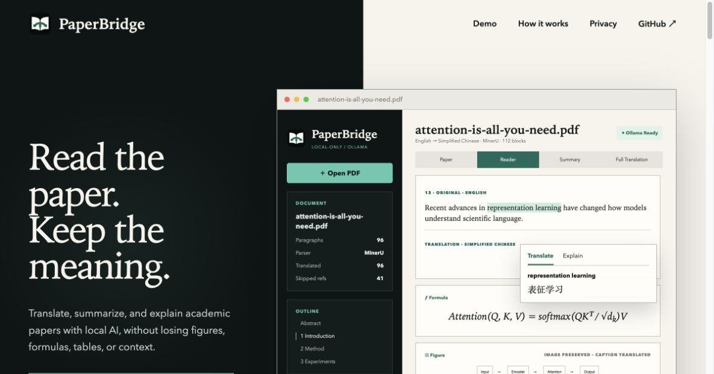

# PaperBridge Website

Marketing and interactive product-demo website for [PaperBridge](https://github.com/haoyunLi/PaperBridge), built with Vue 3, TypeScript, and Vite.



The interactive demo mirrors the native macOS app: PDF and pasted-text sources, MinerU/PDFKit parsing, Ollama model status, Paper/Reader/Summary/Full Translation workspaces, selected-text tools, bilingual captions, and preserved figures and formulas.

## Requirements

- Node.js 22.18 or newer
- npm 10 or newer

## Local development

```bash
npm install
npm run dev
```

Open the local address shown in Terminal, normally `http://localhost:5173`.

## Production build

```bash
npm run build
```

The static site is written to `dist/` and can be deployed with AWS Amplify Hosting or S3 + CloudFront.

## Deploy to AWS Amplify

The included `amplify.yml` installs the required Node version, builds the Vue app, and publishes `dist/`.

1. Push this folder to a GitHub repository, for example `PaperBridge-Website`.
2. Sign in to the AWS account that manages `paperbridges.net`.
3. Open **AWS Amplify → Create new app → GitHub**.
4. Authorize GitHub, choose the website repository and its production branch, then continue.
5. Confirm that Amplify detected `amplify.yml`, then choose **Save and deploy**.
6. After the first deployment succeeds, open **Hosting → Custom domains → Add domain**.
7. Select `paperbridges.net`, map the production branch to the root domain, and add `www` as a redirect to the root domain.
8. Choose the free **Amplify managed certificate** and finish the setup.

Because the domain is managed by Route 53 in the same AWS account, Amplify can create the required DNS verification and HTTPS records automatically. Domain activation can take time while DNS and the certificate propagate.

No environment variables or backend services are required.

## Domain

Production domain: [paperbridges.net](https://paperbridges.net)

## Primary links

- latest macOS direct download: `https://github.com/haoyunLi/PaperBridge/releases/latest/download/PaperBridge.dmg`
- release details: `https://github.com/haoyunLi/PaperBridge/releases/latest`
- current signed release: the latest GitHub Release (Universal, Apple notarized)
- source: `https://github.com/haoyunLi/PaperBridge`
- contact: `info@paperbridges.net`
